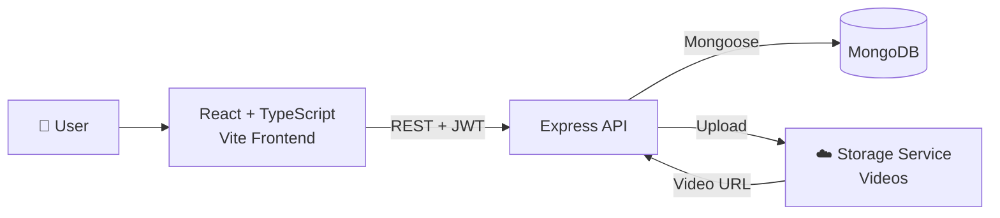
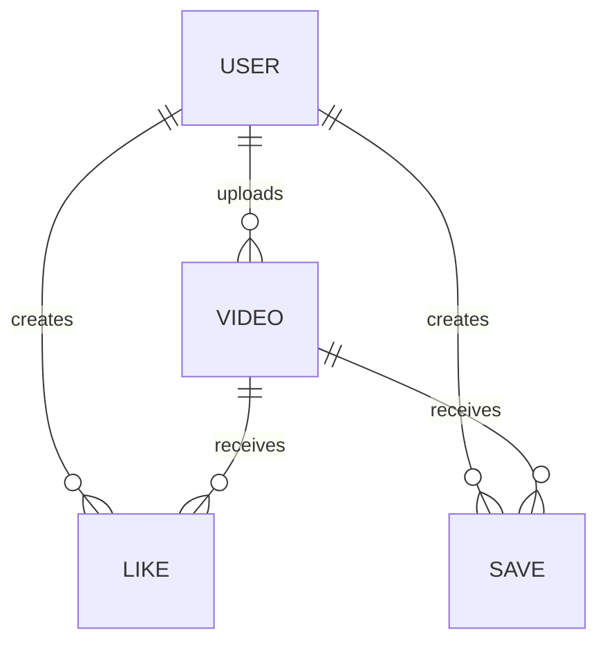

<div align="center">

# 🎬 ReelApp

**A full-stack short-video social platform with a scroll-based reel feed. Discover, watch, like, and save short-form content.**

[**🐛 Report a Bug**](https://github.com/Amjadkhan9756/ReelApp/issues) · [**💡 Request a Feature**](https://github.com/Amjadkhan9756/ReelApp/issues)

[](https://react.dev/)
[](https://www.typescriptlang.org/)
[](https://vite.dev/)
[](https://nodejs.org/)
[](https://expressjs.com/)
[](https://www.mongodb.com/)
[](https://jwt.io/)

</div>

---

## 📖 Table of Contents

- [About](#-about)
- [Features](#-features)
- [Tech Stack](#️-tech-stack)
- [Architecture](#-architecture)
- [Data Models](#️-data-models)
- [Project Structure](#-project-structure)
- [Getting Started](#-getting-started)
- [Environment Variables](#-environment-variables)
- [Scripts](#-scripts)
- [Troubleshooting](#-troubleshooting)
- [Roadmap](#️-roadmap)
- [Contributing](#-contributing)
- [Author](#-author)

---

## 🎯 About

**ReelApp** is a short-video platform inspired by apps like Instagram Reels and TikTok. Users scroll through a vertical feed of reels, watch videos, like and save the ones they enjoy, and upload their own content.

The frontend is a responsive **React 19 + TypeScript** app built with **Vite**. The backend is a **TypeScript + Express 5 REST API** backed by **MongoDB**, with **JWT** authentication protecting private routes and a dedicated storage service handling video uploads.

<!--
📸 Add screenshots here to make the README stand out:


-->

---

## ✨ Features

| Feature | Description |
|---|---|
| 🎞️ **Reel feed** | Scroll-based feed for discovering and watching short-form videos |
| 📱 **Responsive UI** | React + TypeScript interface that works on desktop and mobile |
| 🔐 **Authentication** | Register and log in with JWT, with passwords hashed using bcrypt |
| 🛡️ **Authorization** | Protected routes so only authenticated users can perform restricted actions |
| ⬆️ **Video uploads** | Upload videos with Multer and a dedicated storage service |
| ❤️ **Likes** | Like and unlike reels |
| 🔖 **Saves** | Save reels to watch later |
| 🔌 **REST API** | Resource-based endpoints built with Express 5 |

---

## 🛠️ Tech Stack

<table>
<tr>
<td width="50%" valign="top">

**Frontend**

- **React 19**: UI library
- **TypeScript**: Type safety
- **Vite**: Dev server and build tool
- **React Router 7**: Client-side routing
- **Axios**: API client
- **ESLint**: Linting

</td>
<td width="50%" valign="top">

**Backend**

- **Node.js + TypeScript**: Runtime and language
- **Express 5**: REST API server
- **MongoDB + Mongoose**: Database and ODM
- **JWT (jsonwebtoken)**: Authentication
- **bcryptjs**: Password hashing
- **Multer**: Video upload handling
- **cookie-parser**, **cors**, **dotenv**: Middleware and config
- **tsx**: Fast TypeScript dev runner

</td>
</tr>
</table>

---

## 🧩 Architecture



1. The user registers or logs in and receives a **JWT**.
2. The frontend sends it with each protected request.
3. Uploaded videos go to the storage service, and the returned URL is saved in MongoDB.
4. The feed loads video documents and plays them from the storage URL.

---

## 🗃️ Data Models

The app uses four Mongoose schemas:

| Model | Purpose |
|---|---|
| **User** | Account details and credentials |
| **Video** | Reel metadata, including the storage URL and the uploader |
| **Like** | Links a user to a video they liked |
| **Save** | Links a user to a video they saved |



---

## 📁 Project Structure

```
ReelApp/
├── Frontend/              # React + TypeScript (Vite)
│   ├── src/
│   │   ├── components/    # Reel card, feed, navbar, upload form...
│   │   ├── pages/
│   │   │   ├── auth/
│   │   │   ├── general/
│   │   │   └── video-partner/
│   │   └── ...
│   └── package.json
├── Backend/                # Express + TypeScript API
│   ├── src/
│   │   ├── controllers/
│   │   ├── routes/
│   │   ├── models/         # User, Video, Like, Save
│   │   └── middleware/     # JWT auth
│   ├── server.ts          # Entry point
│   ├── tsconfig.json
│   └── package.json
└── README.md
```

---

## 🚀 Getting Started

### Prerequisites

- [Node.js](https://nodejs.org/) **v20 or higher** recommended
- A [MongoDB](https://cloud.mongodb.com) database (Atlas free tier works)
- An account with your video storage provider
- Git

### 1. Clone the repository

```bash
git clone https://github.com/Amjadkhan9756/ReelApp.git
cd ReelApp
```

### 2. Set up the backend

```bash
cd Backend
npm install
```

Create a `.env` file in `Backend/` (see [Environment Variables](#-environment-variables)), then start the dev server:

```bash
npm run dev
```

This runs `tsx watch server.ts`, so the API restarts automatically when you edit files.

### 3. Set up the frontend

In a new terminal:

```bash
cd Frontend
npm install
```

Create a `.env` file in `Frontend/` with your API URL, then start Vite:

```bash
npm run dev
```

Open **http://localhost:5173** 🎉

### 4. Production build (backend)

```bash
npm run build   # compiles TypeScript to dist/
npm start       # runs dist/server.js
```

---

## 🔑 Environment Variables

> Variable names depend on your code, so rename these to match your project.

### Backend (`Backend/.env`)

| Variable | Required | Description |
|---|:---:|---|
| `PORT` | ➖ | Port the API runs on |
| `MONGO_URI` | ✅ | MongoDB connection string |
| `JWT_SECRET` | ✅ | Secret used to sign JWT tokens |
| `CLIENT_URL` | ➖ | Frontend origin allowed by CORS |
| *Storage keys* | ✅ | Credentials for your video storage service |

### Frontend (`Frontend/.env`)

| Variable | Required | Description |
|---|:---:|---|
| `VITE_API_URL` | ✅ | Base URL of the backend API |

> Vite only exposes variables that start with `VITE_`. Restart the dev server after changing them.

> ⚠️ Never commit `.env` files. Make sure they are listed in `.gitignore`.

---

## 📜 Scripts

| Where | Command | Description |
|---|---|---|
| **Backend** | `npm run dev` | Start the API with `tsx watch` |
| **Backend** | `npm run build` | Compile TypeScript to `dist/` |
| **Backend** | `npm start` | Run the compiled server |
| **Backend** | `npm run typecheck` | Type-check without emitting files |
| **Frontend** | `npm run dev` | Start the Vite dev server |
| **Frontend** | `npm run build` | Type-check and create a production build |
| **Frontend** | `npm run lint` | Run ESLint |
| **Frontend** | `npm run preview` | Preview the production build locally |

---

## 🩺 Troubleshooting

<details>
<summary><b>Videos don't upload</b></summary>

- Check that your storage credentials in `.env` are correct.
- Confirm the file size and format are allowed by your storage provider and your Multer limits.
- Look at the Network tab (F12) for the failing upload request.

</details>

<details>
<summary><b>I get 401 Unauthorized errors</b></summary>

- Make sure you are logged in and the token is being sent (header or cookie).
- Check that `JWT_SECRET` is the same value the token was signed with.

</details>

<details>
<summary><b>The frontend can't reach the API (CORS or network error)</b></summary>

- Verify `VITE_API_URL` points to the running backend, then restart Vite.
- Allow your frontend origin in the backend's CORS configuration.
- If you use cookies across different domains, set `credentials: true` on CORS and Axios, plus `sameSite: "none"` and `secure: true` on the cookie.

</details>

<details>
<summary><b>MongoDB connection fails</b></summary>

- Verify `MONGO_URI` and that special characters in the password are URL-encoded.
- In Atlas, add your IP address under **Network Access**.

</details>

---

## 🗺️ Roadmap

- [ ] Comments on reels
- [ ] Follow and followers system
- [ ] User profile pages
- [ ] Infinite scroll with pagination
- [ ] Search and hashtags
- [ ] Video thumbnails and compression
- [ ] Automated tests and CI/CD pipeline
- [ ] Docker setup

---

## 🤝 Contributing

Contributions are welcome!

1. Fork the repository
2. Create a branch: `git checkout -b feature/amazing-feature`
3. Commit your changes: `git commit -m "Add amazing feature"`
4. Push the branch: `git push origin feature/amazing-feature`
5. Open a Pull Request

---

## 👨‍💻 Author

**Amjad Khan**: [@Amjadkhan9756](https://github.com/Amjadkhan9756)

If you like this project, please consider giving it a ⭐ on GitHub!

---

<div align="center">

**ReelApp**: built with React, TypeScript, Node.js, Express & MongoDB

</div>
